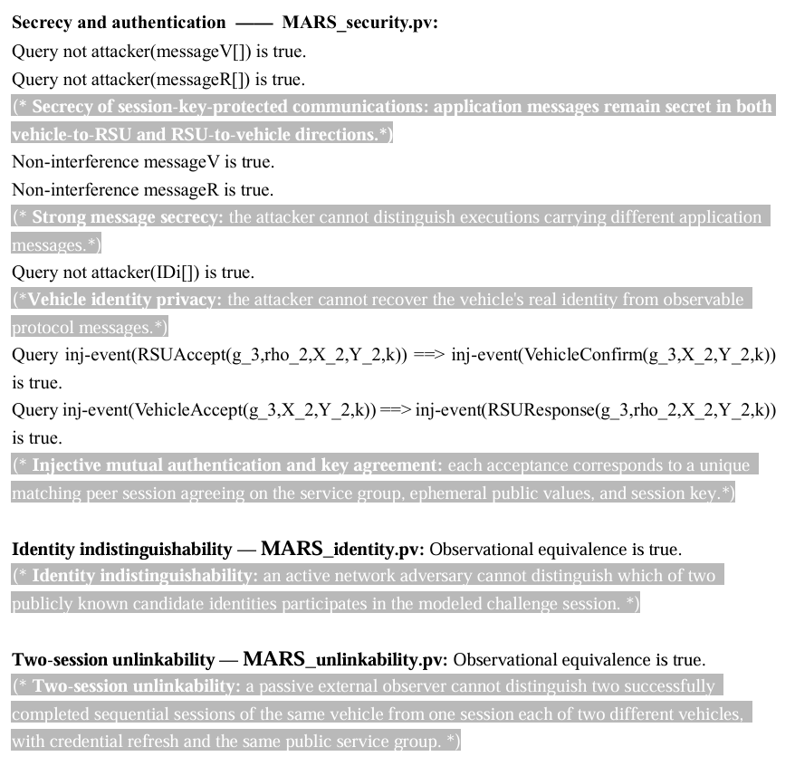

# MARS Supplementary Material

This repository provides supplementary materials for MARS.

## ProVerif Models

- [MARS_Security.pv](./MARS_Security.pv): Application-message secrecy, identity confidentiality, and mutual authentication.
- [MARS_identity.pv](./MARS_identity.pv): Single-session identity indistinguishability against an active network adversary.
- [MARS_unlinkability.pv](./MARS_unlinkability.pv): Two-session unlinkability against a passive external observer, comparing two successfully completed sessions of the same vehicle with one session each of two different vehicles.

The equivalence models assume uncompromised secrets and unchanged valid authorizations within the same service group. They do not model vehicle-memory disclosure or network-level tracking. The unlinkability model explicitly carries the refreshed credential into the next session.

## ProVerif Verification Summary

